# ECG MIT-BIH 1D Residual CNN Architecture

## Metadata
- **Model Name:** ECG MIT-BIH 1D ResNet
- **Department:** Cardiology
- **Task:** 1D Arrhythmia Signal Classification (5 AAMI/MIT-BIH Classes)
- **Model File:** `ecg_mitbih_1dresnet_best.pth`
- **Framework:** PyTorch Custom 1D Residual CNN (`ECG1DCNN`)

---

## Architecture Flow

```mermaid
graph TD
    subgraph InputStage["1. Input Stage"]
        IN["1D ECG Heartbeat Signal Voltage Array (Single Lead)"]
    end

    subgraph PreprocStage["2. Signal Ingestion"]
        IN --> P1["Convert list[float] to PyTorch Tensor: (1, 1, Signal_Length)"]
    end

    subgraph InConvStage["3. Initial Convolution"]
        P1 --> IC["Conv1d(1 -> 32, k=5, p=2) + BatchNorm1d(32) + ReLU + MaxPool1d(2)"]
    end

    subgraph ResStage["4. Residual Stages (3 Blocks)"]
        IC --> RB1["ResidualBlock1D(32):<br/>Conv1d(32, 32, k=5, p=2) + BN + ReLU + Conv1d(32, 32, k=5, p=2) + BN + Skip Addition"]
        RB1 --> DS1["Downsample 1: Conv1d(32 -> 64, k=5, p=2) + BN + ReLU + MaxPool1d(2)"]
        DS1 --> RB2["ResidualBlock1D(64):<br/>Conv1d(64, 64) + BN + ReLU + Conv1d(64, 64) + BN + Skip Addition"]
        RB2 --> DS2["Downsample 2: Conv1d(64 -> 128, k=5, p=2) + BN + ReLU + MaxPool1d(2)"]
        DS2 --> RB3["ResidualBlock1D(128):<br/>Conv1d(128, 128) + BN + ReLU + Conv1d(128, 128) + BN + Skip Addition"]
    end

    subgraph PoolingStage["5. Global Pooling"]
        RB3 --> GAP["AdaptiveAvgPool1d(1) -> 128-dimensional latent vector"]
    end

    subgraph ClassifierStage["6. Fully Connected Classifier"]
        GAP --> DROP["Dropout(p=0.3)"]
        DROP --> FC1["Linear(128 -> 64)"]
        FC1 --> RELU["ReLU Activation"]
        RELU --> FC2["Linear(64 -> 5)"]
        FC2 --> SM["Softmax Activation across 5 Classes"]
    end

    subgraph OutputStage["7. Output Classes"]
        SM --> OUT["5 MIT-BIH AAMI Arrhythmia Classes:<br/>0: Normal Beat (N)<br/>1: Supraventricular Ectopic Beat (S)<br/>2: Ventricular Ectopic Beat (V)<br/>3: Fusion Beat (F)<br/>4: Unknown Beat (Q)<br/>Predicted Class, Confidence %, All Probabilities"]
    end
```

---

## Test & Evaluation Results
- **Evaluation Type:** Evaluation metric not available in project.
- **Results Source:** Architecture defined in `backend/app/services/ecg_service.py` (`ECG1DCNN`).
