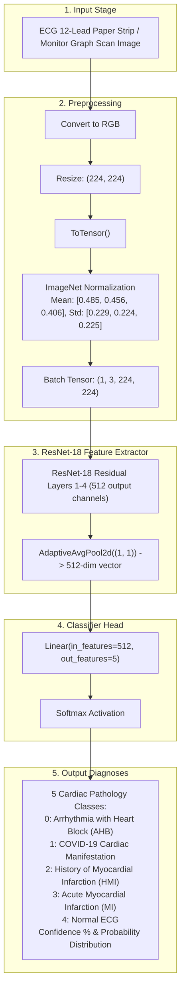

# ECG 12-Lead Vision ResNet-18 Classifier Architecture

## Metadata
- **Model Name:** ECG Vision ResNet-18
- **Department:** Cardiology
- **Task:** 12-Lead ECG Paper Strip Visual Image Classification
- **Model File:** `ecg_vision_resnet18_best.pth`
- **Framework:** PyTorch (`torchvision.models.resnet18` with 5-class FC head)

---

## Architecture Flow

---

## Test & Evaluation Results
- **Evaluation Type:** Evaluation metric not available in project.
- **Results Source:** `build_resnet18_model` in `backend/app/services/ecg_service.py`.
