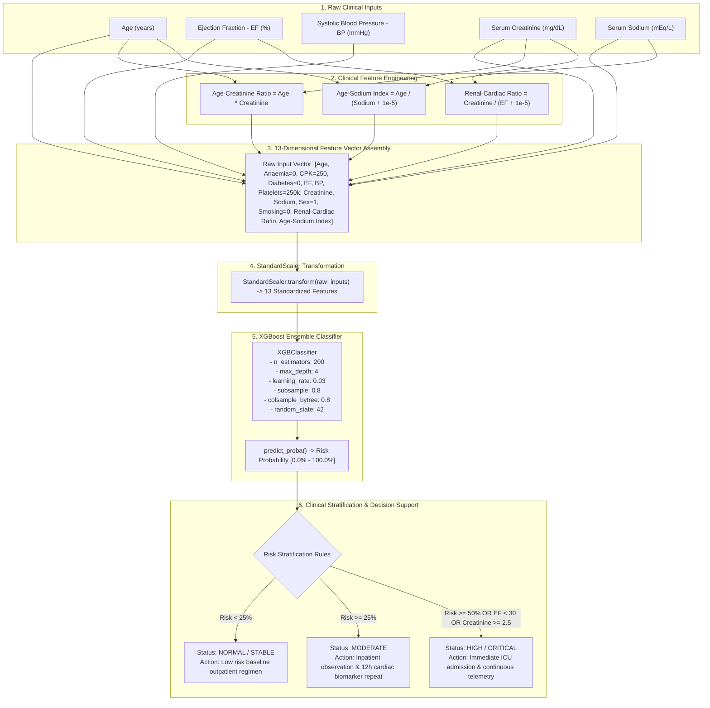

# ICU Clinical Risk XGBoost Classifier Architecture

## Metadata
- **Model Name:** ICU Clinical Deterioration & Mortality Risk Classifier
- **Department:** ICU & Critical Care
- **Task:** Hemodynamic Deterioration & ICU Admission Risk Prediction
- **Model File:** `icu_xgb_model.pkl` (Preprocessor: `icu_xgb_scaler.pkl`)
- **Framework:** Scikit-Learn & XGBoost (`XGBClassifier`)

---

## Architecture Flow

---

## Test & Evaluation Results
- **Evaluation Type:** Test Set Evaluation (80/20 train/test stratified split with SMOTE rebalancing)
- **Evaluation Dataset:** UCI Heart Failure Clinical Records Dataset (`heart_failure_clinical_records_dataset.csv`, 299 patient records)
- **Results Source:** `backend/scripts/train_icu.py`
- **Trained Parameters:** `n_estimators=200, max_depth=4, learning_rate=0.03`
