# Alzheimer Cognitive Impairment Classifier Architecture

## Metadata
- **Model Name:** Alzheimer Dementia Stage Classifier
- **Department:** Neurology & Brain
- **Task:** 4-Stage Dementia & Alzheimer Classification
- **Model File:** `alzheimer_model.pth`
- **Framework:** PyTorch (`torchvision.models.efficientnet_b0`)

---

## Architecture Flow

```mermaid
graph TD
    subgraph InputStage["1. Input Stage"]
        IN["Input Brain Structural MRI Slice"]
    end

    subgraph PreprocStage["2. Preprocessing"]
        IN --> P1["Convert to RGB"]
        P1 --> P2["Resize: (224, 224)"]
        P2 --> P3["ToTensor()"]
        P3 --> P4["ImageNet Normalization<br/>Mean: [0.485, 0.456, 0.406], Std: [0.229, 0.224, 0.225]"]
        P4 --> P5["Batch Dim: (1, 3, 224, 224)"]
    end

    subgraph BackboneStage["3. EfficientNet-B0 Backbone (MBConv Stages)"]
        P5 --> S0["Stem Conv3x3, 32 channels, stride 2"]
        S0 --> S1["Stage 1: MBConv1, k3x3, 16 channels"]
        S1 --> S2["Stage 2: MBConv6, k3x3, 24 channels"]
        S2 --> S3["Stage 3: MBConv6, k5x5, 40 channels"]
        S3 --> S4["Stage 4: MBConv6, k3x3, 80 channels"]
        S4 --> S5["Stage 5: MBConv6, k5x5, 112 channels"]
        S5 --> S6["Stage 6: MBConv6, k5x5, 192 channels"]
        S6 --> S7["Stage 7: MBConv6, k3x3, 320 channels"]
        S7 --> S8["Head Conv1x1, 1280 channels"]
    end

    subgraph HeadStage["4. Pooling & Modified Classifier"]
        S8 --> GAP["AdaptiveAvgPool2d((1, 1)) -> 1280-dim vector"]
        GAP --> DROP["Dropout(p=0.2)"]
        DROP --> FC["Linear(in_features=1280, out_features=4)"]
        FC --> SM["Softmax Activation"]
    end

    subgraph OutputStage["5. Output Diagnosis"]
        SM --> OUT["Predicted Dementia Stage:<br/>- Mild Demented<br/>- Moderate Demented<br/>- Non Demented<br/>- Very Mild Demented<br/>Confidence: Top-1 Softmax Probability %"]
    end
```

---

## Test & Evaluation Results
- **Evaluation Type:** Evaluation metric not available in project.
- **Results Source:** Architecture verified from `backend/app/services/neurology_service.py` and model state_dict.
