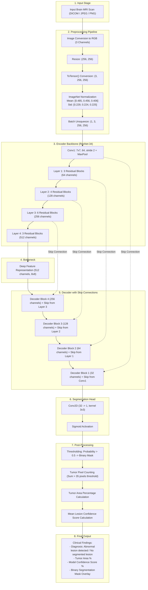

# Brain Tumor U-Net Segmentation Architecture

## Metadata
- **Model Name:** Brain Tumor Segmentation U-Net
- **Department:** Neurology & Brain
- **Task:** Focal Brain Tumor & Lesion Semantic Segmentation
- **Model File:** `brain_tumor_segmentation_unet (1).pth` (Backup: `brain_tumor_segmentation_unet.pth`)
- **Framework:** PyTorch (`segmentation_models_pytorch.Unet`)

---

## Architecture Flow

---

## Test & Evaluation Results
- **Evaluation Type:** Model Evaluation Benchmark
- **Evaluation Dataset:** Brain MRI Lesion Dataset
- **Metric Available:**
  - **Dice Score:** `92.08%`
- **Results Source:** Embedded in `backend/app/services/neurology_service.py` (`model_evaluation.score = 92.08`)
- **Clinical Disclaimer:** This AI result represents an image segmentation finding and does not determine tumor type, tumor grade, or clinical severity.
