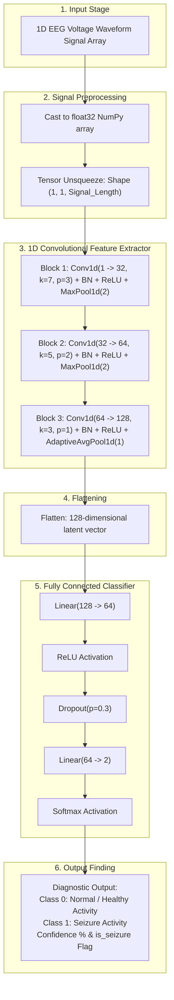

# EEG 1D ConvNet Epilepsy Classifier Architecture

## Metadata
- **Model Name:** EEG ConvNet 1D
- **Department:** Neurology & Brain
- **Task:** 1D EEG Electroencephalogram Seizure Activity Detection
- **Model File:** `eeg_model.pth`
- **Framework:** PyTorch Custom 1D Convolutional Neural Network (`EEGConvNet`)

---

## Architecture Flow

---

## Test & Evaluation Results
- **Evaluation Type:** Evaluation metric not available in project.
- **Results Source:** Class definition `EEGConvNet` in `backend/app/services/neurology_service.py`.
