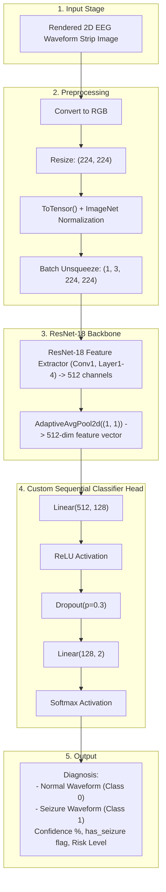

# EEG Vision Waveform Strip Classifier Architecture

## Metadata
- **Model Name:** EEG Waveform Vision Classifier
- **Department:** Neurology & Brain
- **Task:** Visual 2D EEG Strip Seizure Pattern Recognition
- **Model File:** `eeg_image_vision_model.pth`
- **Framework:** PyTorch (`torchvision.models.resnet18` with custom FC head)

---

## Architecture Flow

---

## Test & Evaluation Results
- **Evaluation Type:** Evaluation metric not available in project.
- **Results Source:** Inspected from `eeg_image_model` definition in `backend/app/services/neurology_service.py`.
