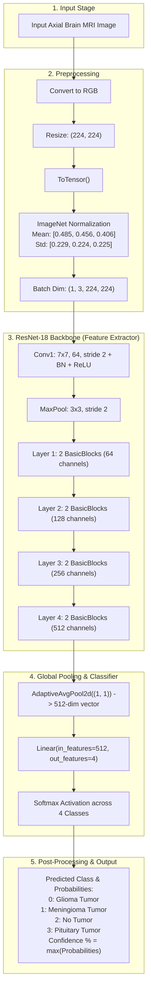

# Neuro Imaging 4-Class Tumor Classifier Architecture

## Metadata
- **Model Name:** Neuro Imaging Brain Tumor Classifier
- **Department:** Neurology & Brain
- **Task:** 4-Class Brain Tumor Categorization
- **Model File:** `neuro_imaging_model.pth`
- **Framework:** PyTorch (`torchvision.models.resnet18`)

---

## Architecture Flow

---

## Test & Evaluation Results
- **Evaluation Type:** Evaluation metric not available in project.
- **Results Source:** Architecture inspected from state_dict (122 tensor layers, fc weight: 4x512).
