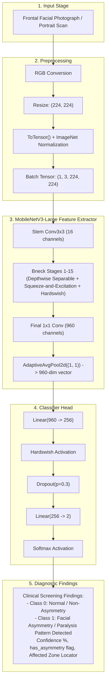

# Facial Paralysis & Asymmetry Vision Classifier Architecture

## Metadata
- **Model Name:** Facial Paralysis & Asymmetry Vision Model
- **Department:** Neurology & Brain
- **Task:** Cranial Nerve VII / Facial Stroke Pattern Screening
- **Model File:** `paralysis_vision_model.pth`
- **Framework:** PyTorch (`torchvision.models.mobilenet_v3_large`)

---

## Architecture Flow

---

## Test & Evaluation Results
- **Evaluation Type:** Evaluation metric not available in project.
- **Results Source:** `paralysis_model` definition and weights inspection in `backend/app/services/neurology_service.py`.
