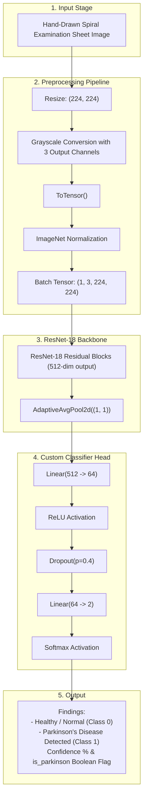

# Parkinson Spiral Motor Examination Classifier Architecture

## Metadata
- **Model Name:** Parkinson Spiral Examination Model
- **Department:** Neurology & Brain
- **Task:** Spiral Drawing Motor Tremor & Parkinson Detection
- **Model File:** `parkinson_model.pth`
- **Framework:** PyTorch (`torchvision.models.resnet18` with custom FC head)

---

## Architecture Flow

---

## Test & Evaluation Results
- **Evaluation Type:** Evaluation metric not available in project.
- **Results Source:** Inspected from `parkinson_img_model` definition in `backend/app/services/neurology_service.py`.
