# Spine Neuropathy DenseNet-121 Classifier Architecture

## Metadata
- **Model Name:** Spine Neuropathy DenseNet-121
- **Department:** Neurology & Brain
- **Task:** Lumbar Spine Stenosis & Herniation Multi-Class Pathology Detection
- **Model File:** `spine_neuropathy_model (1).pth`
- **Framework:** PyTorch (`torchvision.models.densenet121` with custom classifier)

---

## Architecture Flow

```mermaid
graph TD
    subgraph InputStage["1. Input Stage"]
        IN["Lumbar / Sagittal Spine MRI Image"]
    end

    subgraph PreprocStage["2. Preprocessing"]
        IN --> P1["RGB Conversion"]
        P1 --> P2["Resize: (224, 224)"]
        P2 --> P3["ToTensor() + ImageNet Normalization"]
        P3 --> P4["Batch Tensor: (1, 3, 224, 224)"]
    end

    subgraph BackboneStage["3. DenseNet-121 Feature Extractor"]
        P4 --> S0["7x7 Conv + MaxPool (64 channels)"]
        S0 --> DB1["DenseBlock 1 (6 layers, 256 channels)"]
        DB1 --> TB1["Transition Layer 1 (1x1 Conv + 2x2 AvgPool)"]
        TB1 --> DB2["DenseBlock 2 (12 layers, 512 channels)"]
        DB2 --> TB2["Transition Layer 2 (1x1 Conv + 2x2 AvgPool)"]
        TB2 --> DB3["DenseBlock 3 (24 layers, 1024 channels)"]
        DB3 --> TB3["Transition Layer 3 (1x1 Conv + 2x2 AvgPool)"]
        TB3 --> DB4["DenseBlock 4 (16 layers, 1024 channels)"]
        DB4 --> NORM["BatchNorm2d(1024) + ReLU"]
        NORM --> GAP["AdaptiveAvgPool2d((1, 1)) -> 1024-dim vector"]
    end

    subgraph HeadStage["4. Custom Classifier Head"]
        GAP --> FC1["Linear(1024 -> 256)"]
        FC1 --> RELU["ReLU Activation"]
        RELU --> DROP["Dropout(p=0.3)"]
        DROP --> FC2["Linear(256 -> 3)"]
        FC2 --> SM["Softmax Activation"]
    end

    subgraph OutputStage["5. Output Diagnosis"]
        SM --> OUT["3 Pathological Classes:<br/>0: Herniated Disc<br/>1: No Stenosis (Normal)<br/>2: Thecal Sac Pathology<br/>Confidence % & is_pathology boolean"]
    end
```

---

## Test & Evaluation Results
- **Evaluation Type:** Validation & Training Evaluation
- **Evaluation Dataset:** Lumbar Spine MRI Evaluation Set
- **Metrics Available:**
  - **Validation Accuracy:** `96.11%`
  - **Train Accuracy:** `99.96%`
- **Results Source:** Embedded in `backend/app/services/neurology_service.py` (`model_evaluation.validation_accuracy = 96.11`, `train_accuracy = 99.96`)
- **Clinical Disclaimer:** AI screening result only - not a definitive diagnosis. Final clinical interpretation requires review by a qualified radiologist or spine specialist.
