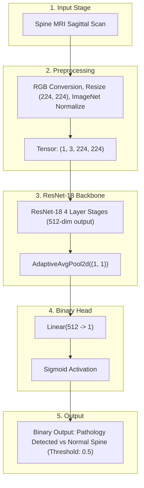

# Spine Neuropathy ResNet-18 Binary Classifier Architecture

## Metadata
- **Model Name:** Spine ResNet-18 Binary Classifier (Legacy Backup)
- **Department:** Neurology & Brain
- **Task:** Binary Spinal Pathology Detection
- **Model File:** `spine_neuropathy_model.pth`
- **Framework:** PyTorch (`torchvision.models.resnet18`)

---

## Architecture Flow

---

## Test & Evaluation Results
- **Evaluation Type:** Evaluation metric not available in project.
- **Results Source:** `spine_model` definition in `backend/app/services/neurology_service.py`.
