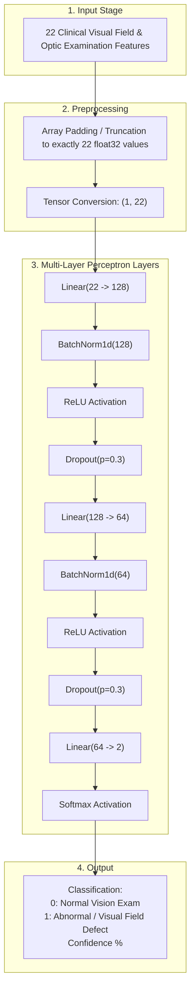

# Vision Exam Tabular MLP Classifier Architecture

## Metadata
- **Model Name:** Vision Exam Net
- **Department:** Neurology & Brain
- **Task:** Multi-Parameter Visual Field Defect Detection
- **Model File:** `vision_exam_model.pth`
- **Framework:** PyTorch (`VisionExamNet` Multi-Layer Perceptron)

---

## Architecture Flow

---

## Test & Evaluation Results
- **Evaluation Type:** Evaluation metric not available in project.
- **Results Source:** Inspected from `VisionExamNet` definition in `backend/app/services/neurology_service.py`.
