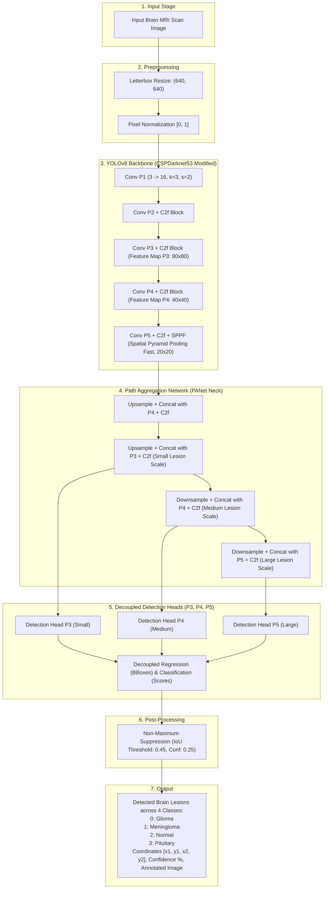

# YOLOv8 Brain MRI Lesion Detector Architecture

## Metadata
- **Model Name:** YOLOv8 Brain MRI Object Detector
- **Department:** Neurology & Brain
- **Task:** Brain Tumor Localization & Bounding Box Detection
- **Model File:** `yolov8_mri.pt`
- **Framework:** Ultralytics YOLOv8 (PyTorch)

---

## Architecture Flow

---

## Test & Evaluation Results
- **Evaluation Type:** Evaluation metric not available in project.
- **Results Source:** Model metadata inspected from `backend/app/models/yolov8_mri.pt`.
