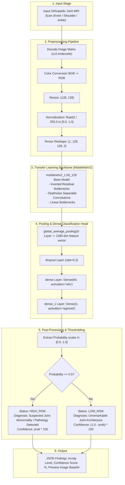

# Orthopedics MRI Joint Pathology Classifier Architecture

## Metadata
- **Model Name:** Orthopedics MRI Joint Abnormality Classifier
- **Department:** Orthopedics
- **Task:** Binary Joint Structural Abnormality & Focal Lesion Screening
- **Model File:** `mri_classifier.keras`
- **Framework:** Keras 3 with PyTorch Backend (`keras.src.models.sequential.Sequential`)

---

## Architecture Flow

---

## Test & Evaluation Results
- **Evaluation Type:** Evaluation metric not available from the supplied artifacts.
- **Results Source:** Architecture verified from `mri_classifier.keras` layer inspection and `orthopedics_service.py`.
- **Clinical Disclaimer:** AI decision-support output only. Not a definitive medical diagnosis. Clinical correlation by a licensed radiologist or orthopedic specialist is required.
