# Orthopedics MRI Joint Segmentation U-Net Architecture

## Metadata
- **Model Name:** Orthopedics MRI Joint Segmentation U-Net
- **Department:** Orthopedics
- **Task:** MRI Joint / Soft Tissue Focal Lesion Pixel-Level Segmentation
- **Model File:** `mri_unet_segmentation.keras`
- **Framework:** Keras 3 with PyTorch Backend (`keras.src.models.functional.Functional`, 32 Layers)

---

## Architecture Flow

```mermaid
graph TD
    subgraph InputStage["1. Input Stage"]
        IN["Input Orthopedic Joint MRI Image Slice"]
    end

    subgraph PreprocStage["2. Grayscale Preprocessing"]
        IN --> P1["Decode Grayscale Image Matrix (cv2.IMREAD_GRAYSCALE)"]
        P1 --> P2["Resize: (128, 128)"]
        P2 --> P3["Normalize float32 / 255.0 to [0.0, 1.0]"]
        P3 --> P4["Tensor Reshape: (1, 128, 128, 1)"]
    end

    subgraph EncoderStage["3. U-Net Encoder Contracting Path (4 Levels)"]
        P4 --> E1["Level 1: Conv2D(64, 3x3) + Conv2D(64, 3x3) -> Skip Connection 1"]
        E1 --> MP1["MaxPooling2D(2x2) -> (64, 64, 64)"]
        MP1 --> E2["Level 2: Conv2D(128, 3x3) + Conv2D(128, 3x3) -> Skip Connection 2"]
        E2 --> MP2["MaxPooling2D(2x2) -> (32, 32, 128)"]
        MP2 --> E3["Level 3: Conv2D(256, 3x3) + Conv2D(256, 3x3) -> Skip Connection 3"]
        E3 --> MP3["MaxPooling2D(2x2) -> (16, 16, 256)"]
    end

    subgraph BottleneckStage["4. Bottleneck"]
        MP3 --> BN["Bottleneck: Conv2D(512, 3x3) + Conv2D(512, 3x3) -> (16, 16, 512)"]
    end

    subgraph DecoderStage["5. U-Net Decoder Expanding Path with Skip Concatenations"]
        BN --> UP3["UpSampling2D(2x2) + Concatenate(Skip Connection 3)"]
        E3 -. Skip 3 .-> UP3
        UP3 --> D3["Conv2D(256) + Conv2D(256) -> (32, 32, 256)"]

        D3 --> UP2["UpSampling2D(2x2) + Concatenate(Skip Connection 2)"]
        E2 -. Skip 2 .-> UP2
        UP2 --> D2["Conv2D(128) + Conv2D(128) -> (64, 64, 128)"]

        D2 --> UP1["UpSampling2D(2x2) + Concatenate(Skip Connection 1)"]
        E1 -. Skip 1 .-> UP1
        UP1 --> D1["Conv2D(64) + Conv2D(64) -> (128, 128, 64)"]
    end

    subgraph HeadStage["6. Output Segmentation Layer"]
        D1 --> CONV_OUT["Conv2D(filters=1, kernel_size=1x1, activation='sigmoid')"]
        CONV_OUT --> MASK_RAW["Output Raw Mask Tensor: Shape (128, 128, 1)"]
    end

    subgraph PostProcStage["7. Post-Processing & Overlay Generation"]
        MASK_RAW --> THRESH["Binarization: Mask > 0.5 Threshold"]
        THRESH --> STATS["Calculate Lesion Area % = (Lesion Pixels / Total Pixels) * 100"]
        STATS --> COLOR["Color Mask Alpha Blending (Green/Red Lesion Tint over Grayscale Base)"]
        COLOR --> B64["Encode Annotated PNG Overlay to Base64 URI"]
    end

    subgraph OutputStage["8. Findings"]
        B64 --> OUT["Clinical Findings:<br/>- Lesion Detected Flag (Area > 0.05%)<br/>- Lesion Area %<br/>- Mean Lesion Pixel Confidence %<br/>- Mask Overlay Base64 Image"]
    end
```

---

## Test & Evaluation Results
- **Evaluation Type:** Evaluation metric not available from the supplied artifacts.
- **Results Source:** Architecture verified from `mri_unet_segmentation.keras` 32-layer inspection and `orthopedics_service.py`.
- **Clinical Disclaimer:** AI decision-support output only. Not a definitive medical diagnosis. Clinical correlation by a licensed radiologist or orthopedic specialist is required.
