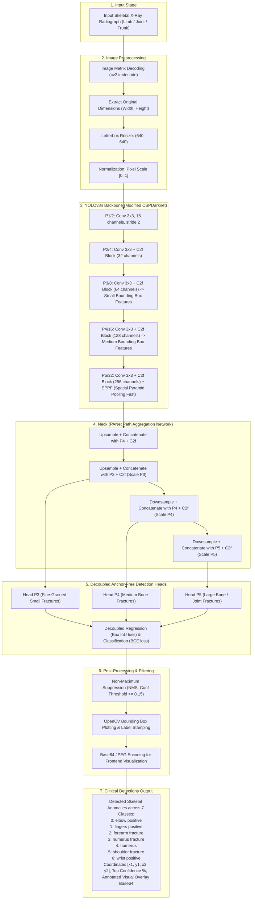

# Orthopedics YOLOv8 Bone Fracture Detector Architecture

## Metadata
- **Model Name:** Orthopedics Bone Radiograph Fracture Detector
- **Department:** Orthopedics
- **Task:** Multi-Class Anatomical Bone Fracture Localization & Object Detection
- **Model File:** `best.pt` (Backup Checkpoint: `last.pt`)
- **Framework:** Ultralytics YOLOv8n (8.4.150) PyTorch Checkpoint
- **Checkpoint Relationship:** `best.pt` and `last.pt` originate from the same 50-epoch training run; `best.pt` selected for peak validation fitness at epoch 25.

---

## Architecture Flow

---

## Test & Evaluation Results
- **Evaluation Type:** Validation Evaluation (Epoch 25 Peak Fitness Checkpoint)
- **Evaluation Dataset:** Bone Fracture Radiograph Validation Set
- **Actual Results:**
  - **mAP50:** `29.89%`
  - **mAP50-95:** `10.28%`
  - **Precision:** `33.02%`
  - **Recall:** `31.30%`
- **Results Source:** Embedded training checkpoint metadata in `best.pt` (`orthopedics_service.py` L78-84).
- **Clinical Disclaimer:** AI decision-support output only. Not a definitive medical diagnosis. Clinical correlation by a licensed radiologist or orthopedic specialist is required.
