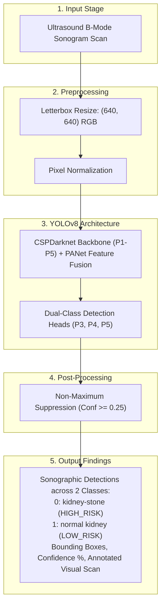

# General Ultrasound YOLOv8 Kidney Anomaly Detector Architecture

## Metadata
- **Model Name:** Ultrasound YOLOv8 Anomaly Detector
- **Department:** Orthopedics / General Imaging
- **Task:** Sonographic Kidney Stone & Tissue Localization
- **Model File:** `yolov8_ultrasound.pt`
- **Framework:** Ultralytics YOLOv8 (PyTorch)

---

## Architecture Flow

---

## Test & Evaluation Results
- **Evaluation Type:** Evaluation metric not available in project.
- **Results Source:** Model metadata inspected from `backend/app/models/yolov8_ultrasound.pt` (`ultrasound_service.py`).
