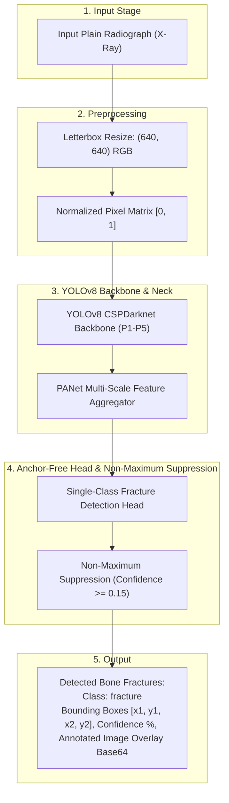

# General Radiography YOLOv8 Fracture Detector Architecture

## Metadata
- **Model Name:** General X-Ray Fracture Detector
- **Department:** Orthopedics
- **Task:** General Bone Fracture Radiographic Localization
- **Model File:** `yolov8_xray.pt`
- **Framework:** Ultralytics YOLOv8 (PyTorch)

---

## Architecture Flow

---

## Test & Evaluation Results
- **Evaluation Type:** Evaluation metric not available in project.
- **Results Source:** Model metadata inspected from `backend/app/models/yolov8_xray.pt` (`xray_service.py`).
