# Lung Auscultation Audio ResNet-34 Classifier Architecture

## Metadata
- **Model Name:** Lung Sounds Multi-Disease Audio ResNet-34
- **Department:** Pulmonology (Respiratory)
- **Task:** 6-Class Acoustic Respiratory Sound Classification
- **Model File:** `lung_audio_multi_disease.pth`
- **Framework:** PyTorch (`timm.create_model("resnet34", num_classes=6)`) with Librosa Audio Pipeline

---

## Architecture Flow

```mermaid
graph TD
    subgraph InputStage["1. Audio Ingestion"]
        IN["Stethoscope Lung Auscultation Sound File (WAV / UploadFile / Bytes)"]
    end

    subgraph AudioPreproc["2. Acoustic Signal Preprocessing (Librosa)"]
        IN --> A1["librosa.load(sr=16000, duration=5.0s)"]
        A1 --> A2["Fixed-Length Padding / Truncation (80,000 samples)"]
        A2 --> A3["Mel-Spectrogram Generation (n_mels=128, sr=16000)"]
        A3 --> A4["Log-Amplitude Conversion: librosa.power_to_db(ref=max)"]
        A4 --> A5["Min-Max Intensity Normalization to [0, 255] uint8"]
        A5 --> A6["cv2.cvtColor(GRAY2RGB) -> 3-Channel Spectrogram Image"]
        A6 --> A7["Resize to (224, 224) + ImageNet Normalize"]
        A7 --> TENSOR["Batch Tensor: (1, 3, 224, 224)"]
    end

    subgraph BackboneStage["3. ResNet-34 2D Vision Backbone"]
        TENSOR --> CONV1["Conv1: 7x7, 64 channels, s=2 + MaxPool"]
        CONV1 --> L1["Layer 1: 3 Residual Blocks (64 channels)"]
        L1 --> L2["Layer 2: 4 Residual Blocks (128 channels, s=2)"]
        L2 --> L3["Layer 3: 6 Residual Blocks (256 channels, s=2)"]
        L3 --> L4["Layer 4: 3 Residual Blocks (512 channels, s=2)"]
    end

    subgraph HeadStage["4. Pooling & Classification Head"]
        L4 --> GAP["Global Average Pooling (512-dim vector)"]
        GAP --> FC["Linear(512 -> 6)"]
        FC --> SM["Softmax Activation"]
    end

    subgraph OutputStage["5. Respiratory Diagnoses"]
        SM --> OUT["6 Respiratory Disease Categories:<br/>0: COPD<br/>1: Healthy<br/>2: Upper Respiratory Tract Infection (URTI)<br/>3: Bronchiectasis<br/>4: Pneumonia<br/>5: Bronchiolitis<br/>Diagnosis Finding, Risk Level, Confidence %"]
    end
```

---

## Test & Evaluation Results
- **Evaluation Type:** Evaluation metric not available in project.
- **Results Source:** `RespiratoryService.predict_audio` in `backend/app/services/respiratory_service.py`.
