# Lung CT-Scan DenseNet-121 Classifier Architecture

## Metadata
- **Model Name:** Lung CT-Scan DenseNet-121
- **Department:** Pulmonology (Respiratory)
- **Task:** 4-Class Thoracic CT Lung Cancer & Malignancy Subtyping
- **Model File:** `lung_ctscan_densenet.pth`
- **Framework:** PyTorch (`timm.create_model("densenet121", num_classes=4)`)

---

## Architecture Flow

```mermaid
graph TD
    subgraph InputStage["1. Input Stage"]
        IN["High-Resolution Chest CT Scan Slice"]
    end

    subgraph PreprocStage["2. Preprocessing"]
        IN --> P1["Decode Image Matrix (cv2)"]
        P1 --> P2["Resize: (224, 224) RGB"]
        P2 --> P3["ToTensor() + ImageNet Normalization"]
        P3 --> P4["Batch Tensor: (1, 3, 224, 224)"]
    end

    subgraph BackboneStage["3. DenseNet-121 Dense Connectivity"]
        P4 --> STEM["7x7 Conv, 64 channels, s=2 + MaxPool 3x3"]
        STEM --> DB1["DenseBlock 1 (6 layers, 256 channels)"]
        DB1 --> TL1["Transition Layer 1 (1x1 Conv + 2x2 AvgPool)"]
        TL1 --> DB2["DenseBlock 2 (12 layers, 512 channels)"]
        DB2 --> TL2["Transition Layer 2 (1x1 Conv + 2x2 AvgPool)"]
        TL2 --> DB3["DenseBlock 3 (24 layers, 1024 channels)"]
        DB3 --> TL3["Transition Layer 3 (1x1 Conv + 2x2 AvgPool)"]
        TL3 --> DB4["DenseBlock 4 (16 layers, 1024 channels)"]
        DB4 --> BN["BatchNorm + ReLU"]
    end

    subgraph HeadStage["4. Classifier Head"]
        BN --> GAP["Global Average Pooling (1024-dim vector)"]
        GAP --> FC["Linear(1024 -> 4)"]
        FC --> SM["Softmax Probability"]
    end

    subgraph OutputStage["5. Oncological Findings"]
        SM --> OUT["4 Histopathological Classes:<br/>0: Adenocarcinoma<br/>1: Large Cell Carcinoma<br/>2: Squamous Cell Carcinoma<br/>3: Normal Lung<br/>Diagnosis Finding, Malignancy Risk Level, Confidence %"]
    end
```

---

## Test & Evaluation Results
- **Evaluation Type:** Evaluation metric not available in project.
- **Results Source:** `RespiratoryService.predict_ctscan` in `backend/app/services/respiratory_service.py`.
