# Lung Ultrasound ConvNeXt-Small Classifier Architecture

## Metadata
- **Model Name:** Lung Ultrasound ConvNeXt-Small
- **Department:** Pulmonology (Respiratory)
- **Task:** 3-Class Point-of-Care Lung Ultrasound (POCUS) Classification
- **Model File:** `lung_ultrasound_convnext.pth`
- **Framework:** PyTorch (`timm.create_model("convnext_small", num_classes=3)`)

---

## Architecture Flow

```mermaid
graph TD
    subgraph InputStage["1. Input Stage"]
        IN["Lung Ultrasound (LUS) B-Mode Scan Image"]
    end

    subgraph PreprocStage["2. Preprocessing"]
        IN --> P1["BGR to RGB Conversion"]
        P1 --> P2["Resize: (224, 224)"]
        P2 --> P3["ToTensor() + ImageNet Normalization"]
        P3 --> P4["Batch Tensor: (1, 3, 224, 224)"]
    end

    subgraph BackboneStage["3. ConvNeXt-Small Backbone"]
        P4 --> STEM["Patchify Stem: 4x4 Conv (96 channels, s=4)"]
        STEM --> ST1["Stage 1: 3 ConvNeXt Blocks (96 channels)"]
        ST1 --> DS1["Downsample 1: 2x2 Conv (192 channels, s=2)"]
        DS1 --> ST2["Stage 2: 3 ConvNeXt Blocks (192 channels)"]
        ST2 --> DS2["Downsample 2: 2x2 Conv (384 channels, s=2)"]
        DS2 --> ST3["Stage 3: 27 ConvNeXt Blocks (384 channels)"]
        ST3 --> DS3["Downsample 3: 2x2 Conv (768 channels, s=2)"]
        DS3 --> ST4["Stage 4: 3 ConvNeXt Blocks (768 channels)"]
    end

    subgraph HeadStage["4. Pooling & Classifier Head"]
        ST4 --> NORM["LayerNorm(768)"]
        NORM --> GAP["Global Average Pooling (768-dim vector)"]
        GAP --> FC["Linear(768 -> 3)"]
        FC --> SM["Softmax Activation"]
    end

    subgraph OutputStage["5. Findings"]
        SM --> OUT["3 Ultrasound Classes:<br/>0: COVID-19<br/>1: Normal<br/>2: Pneumonia<br/>Diagnosis, Risk Level, Confidence %"]
    end
```

---

## Test & Evaluation Results
- **Evaluation Type:** Evaluation metric not available in project.
- **Results Source:** `RespiratoryService.predict_ultrasound` in `backend/app/services/respiratory_service.py`.
