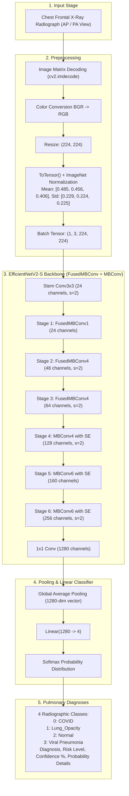

# Chest X-Ray EfficientNetV2-S Classifier Architecture

## Metadata
- **Model Name:** Lung Chest X-Ray EfficientNetV2-S
- **Department:** Pulmonology (Respiratory)
- **Task:** 4-Class Radiographic Pulmonary Pathology Classification
- **Model File:** `lung_xray_effnetv2.pth`
- **Framework:** PyTorch (`timm.create_model("tf_efficientnetv2_s", num_classes=4)`)

---

## Architecture Flow

---

## Test & Evaluation Results
- **Evaluation Type:** Evaluation metric not available in project.
- **Results Source:** `RespiratoryService.predict_xray` in `backend/app/services/respiratory_service.py`.
