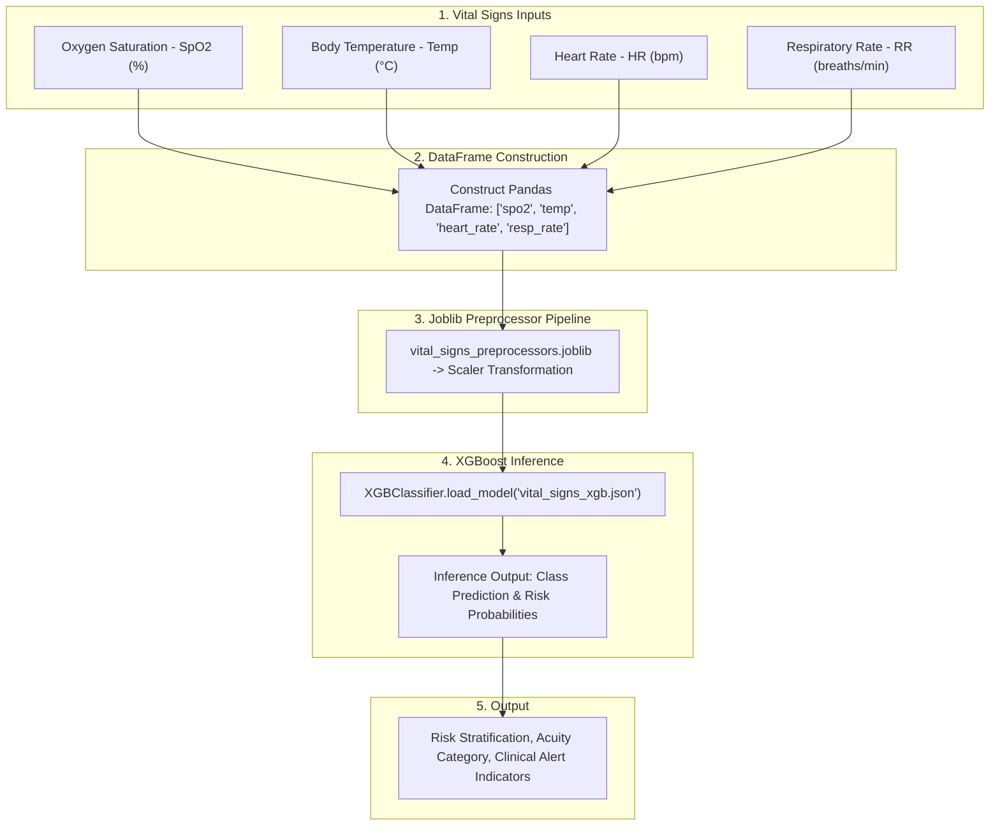

# Vital Signs XGBoost Risk Classifier Architecture

## Metadata
- **Model Name:** Vital Signs Clinical Risk Classifier
- **Department:** Pulmonology (Respiratory)
- **Task:** 4-Feature Hemodynamic & Respiratory Decompensation Assessment
- **Model File:** `vital_signs_xgb.json` (Preprocessor: `vital_signs_preprocessors.joblib`)
- **Framework:** XGBoost & Scikit-Learn (`xgb.XGBClassifier`)

---

## Architecture Flow

---

## Test & Evaluation Results
- **Evaluation Type:** Evaluation metric not available in project.
- **Results Source:** `vital_signs_xgb.json` inspected from `backend/app/models/vital_signs_xgb.json`.
