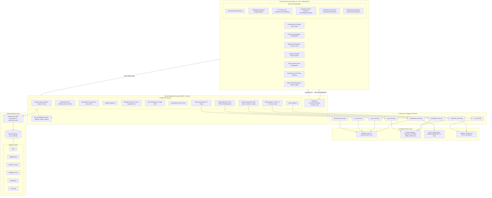

# System Architecture Diagram

This diagram represents the actual implemented software architecture of **AuraHealth Core**, illustrating the client interface, API routing layer, security middleware, AI service layer, ORM persistence layer, and the underlying database.

