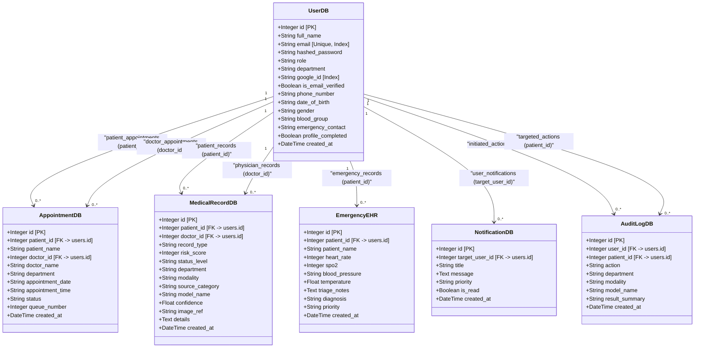

# Class Diagram

Based directly on the actual SQLAlchemy model definitions in `backend/app/models/db_models.py`, capturing exact primary keys, foreign keys, data types, attributes, and relationships.

