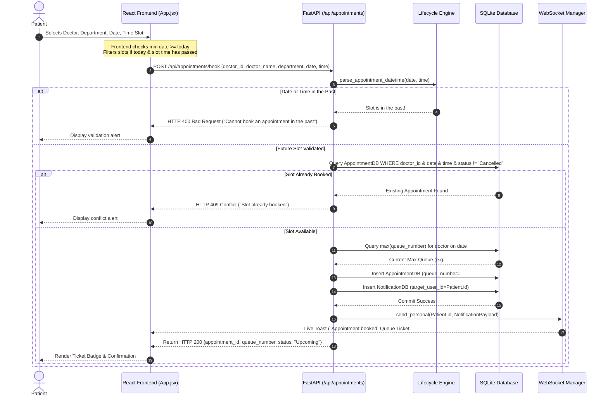

# Sequence Diagram — Appointment Booking & Lifecycle Verification

Illustrates the end-to-end appointment booking workflow with strict frontend and backend past-date/time validation, slot collision detection, and personal notification dispatch.

